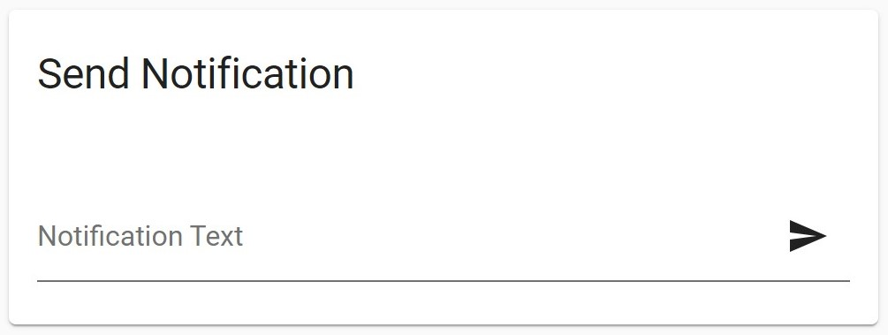
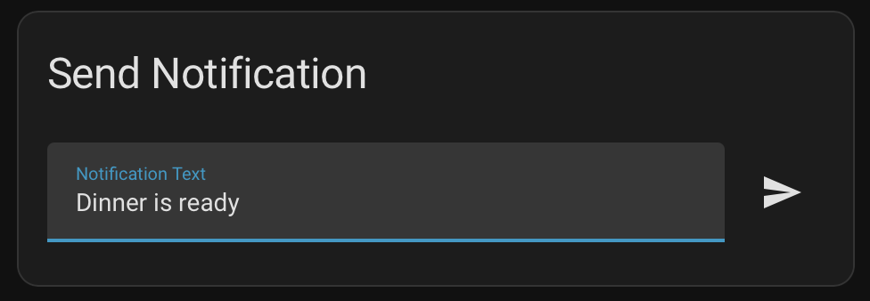
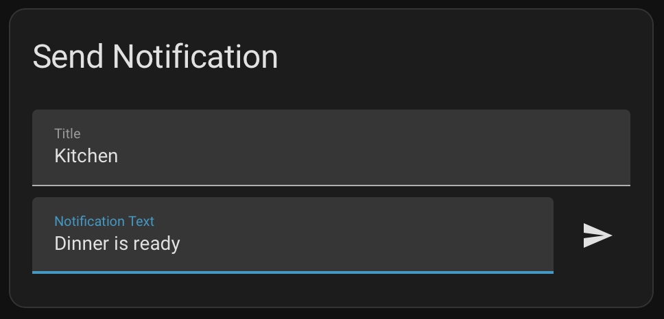

<!--
SPDX-FileCopyrightText: 2021 bernikr <hi@berni.kr>

SPDX-License-Identifier: MIT
-->

# Notify Card for Lovelace/Home Assistant

[](https://buymeacoffee.com/bernikr)
[](https://t.me/bernikr)

This simple card allows you to notify any notification service manually from the dashboard.



<!-- ha-marketplace:exclude-start -->

## Install

### Install via Marketplace (recommended)

For Home Assistant 2026.11 and later:

[](https://my.home-assistant.io/redirect/marketplace_repository/?owner=bernikr&repository=lovelace-notify-card)

1. Go to Settings → Marketplace
2. Search for `Notify Card`
3. Install it and reload your browser

### HACS (Home Assistant 2026.10 and earlier)

1. Go to the "Frontend"-tab in HACS
2. Click on "Explore & Add Repositories"
3. Search for `Notify Card`
4. Click "Install this Repository in HACS"

### Manual install

1. Copy the `notify-card.js` file to your `config/www` folder
2. Add a reference in the resource config:

```yaml
resources:
  - url: /local/notify-card.js
    type: module
```

<!-- ha-marketplace:exclude-end -->

## How the card works

The card has a text field and a send button. When you press send (or Enter), the card builds the action's data from your config, puts the text you typed wherever the config asks for it, and calls the action. The text you typed is available as `{{ msg }}`.



The card can be configured in two styles. Use the new style for new cards; old style cards keep working unchanged.

## New style

The new style is what the visual editor creates. The action is configured under `send_action`, in the same format as a dashboard `tap_action` with `action: perform-action`, so anything you can call from a button can be called from this card.

### Setting up a card in the visual editor

1. Edit a dashboard, click "Add card" and choose "Notify Card"
2. Under "Send action", choose the action to perform when a message is sent, for example `notify.mobile_app_phone`, `notify.send_message` or `tts.speak`. The editor then shows that action's fields and targets
3. Leave the message empty to send the text typed into the card, or use `{{ msg }}` wherever you want that text
4. Optionally change the card title, text field label, send button icon and the two switches

### Options

| Option                       | Default             | Description                                                                                                                        |
| ---------------------------- | ------------------- | ---------------------------------------------------------------------------------------------------------------------------------- |
| `send_action`                | required            | The action performed when a message is sent                                                                                        |
| `send_action.action`         |                     | Always `perform-action`                                                                                                            |
| `send_action.perform_action` |                     | The action to call, for example `notify.living_room_tv`                                                                            |
| `send_action.data`           |                     | Optional data passed to the action. Supports templates                                                                             |
| `send_action.target`         |                     | Optional entities, devices or areas the action targets                                                                             |
| `card_title`                 | `Send Notification` | Title shown at the top of the card                                                                                                 |
| `show_title`                 | `true`              | Set to `false` to hide the title and remove the header padding                                                                     |
| `label`                      | `Notification Text` | Label of the text field                                                                                                            |
| `icon`                       | `mdi:send`          | Icon of the send button                                                                                                            |
| `group`                      | `false`             | Set to `true` when embedding inside another card: removes the border, box shadow and background so the card blends into its parent |
| `notification_title`         | none                | Adds a notification title, typed on the card or fixed (YAML only)                                                                  |

### Building the message

These variables can be used in `send_action.data`:

| Variable          | Value                                                                     |
| ----------------- | ------------------------------------------------------------------------- |
| `{{ msg }}`       | The text typed into the card                                              |
| `{{ title }}`     | The notification title, if `notification_title` is set; otherwise empty   |
| `{{ user.name }}` | The name of the user sending the message (`user` is the full user object) |

Any other Home Assistant template is rendered too, with `msg`, `title` and `user` as variables. Templates work for users who are not administrators.

If the action has a `message` field and `data` doesn't set one, the typed text is sent as the message.

### Examples

In each example, someone types `Dinner is ready` and presses send.

#### Send the typed text

```yaml
type: custom:notify-card
send_action:
  action: perform-action
  perform_action: notify.mobile_app_phone
```

The action has a `message` field and none is set, so the typed text is the message. The card calls:

```yaml
action: notify.mobile_app_phone
data:
  message: Dinner is ready
```

The phone shows **Dinner is ready**.

#### Add text around the message

```yaml
type: custom:notify-card
send_action:
  action: perform-action
  perform_action: notify.mobile_app_phone
  data:
    message: "Kitchen: {{ msg }}"
```

The card calls:

```yaml
action: notify.mobile_app_phone
data:
  message: "Kitchen: Dinner is ready"
```

The phone shows **Kitchen: Dinner is ready**.

#### Say who sent it

```yaml
type: custom:notify-card
send_action:
  action: perform-action
  perform_action: notify.mobile_app_phone
  data:
    message: "{{ user.name }}: {{ msg }}"
```

If Alex is logged in, the card calls:

```yaml
action: notify.mobile_app_phone
data:
  message: "Alex: Dinner is ready"
```

The phone shows **Alex: Dinner is ready**.

#### Let people type a title

`notification_title` with `input` adds a second text field to the card. Its text is `{{ title }}`. Set the field's label with `input`, or leave it empty for "Notification Title".

```yaml
type: custom:notify-card
notification_title:
  input: Title
send_action:
  action: perform-action
  perform_action: notify.mobile_app_phone
  data:
    message: "{{ msg }}"
    title: "{{ title }}"
```

Someone types `Kitchen` as the title and `Dinner is ready` as the text:



The card calls:

```yaml
action: notify.mobile_app_phone
data:
  message: Dinner is ready
  title: Kitchen
```

The phone shows a notification titled **Kitchen** with the text **Dinner is ready**.

#### Use a fixed title

```yaml
type: custom:notify-card
notification_title: Kitchen
send_action:
  action: perform-action
  perform_action: notify.mobile_app_phone
  data:
    title: "{{ title }}"
```

The card has no title field, `{{ title }}` is always `Kitchen`, and the typed text is the message. The card calls:

```yaml
action: notify.mobile_app_phone
data:
  message: Dinner is ready
  title: Kitchen
```

#### Speak the message on a speaker

```yaml
type: custom:notify-card
send_action:
  action: perform-action
  perform_action: tts.speak
  target:
    entity_id: tts.home_assistant_cloud
  data:
    media_player_entity_id: media_player.kitchen
```

The card calls:

```yaml
action: tts.speak
target:
  entity_id: tts.home_assistant_cloud
data:
  media_player_entity_id: media_player.kitchen
  message: Dinner is ready
```

The kitchen speaker says **"Dinner is ready"**. The speaker must be able to play Home Assistant's text-to-speech audio. Some speakers, such as Amazon Echo devices, need their own integration's notify action instead.

#### Send to several notify entities

```yaml
type: custom:notify-card
send_action:
  action: perform-action
  perform_action: notify.send_message
  target:
    entity_id:
      - notify.living_room_tv
      - notify.kitchen_display
```

The card calls:

```yaml
action: notify.send_message
target:
  entity_id:
    - notify.living_room_tv
    - notify.kitchen_display
data:
  message: Dinner is ready
```

Both displays show **Dinner is ready**.

#### Change how the card looks

A custom icon and title:

```yaml
type: custom:notify-card
card_title: Kitchen announcements
label: What should we say?
icon: mdi:bullhorn
send_action:
  action: perform-action
  perform_action: notify.mobile_app_phone
```

Embedded in an entities card without a title, border or background:

```yaml
type: entities
entities:
  - entity: input_number.some_helper
  - type: custom:notify-card
    show_title: false
    group: true
    send_action:
      action: perform-action
      perform_action: notify.mobile_app_phone
```

## Old style

Cards written before the visual editor existed use one of two old styles. They keep working, but they open in the YAML editor instead of the visual editor. The card options (`card_title`, `label`, `icon`, `group`, `notification_title`) work the same in both styles, and `card_title: false` hides the title like `show_title: false`.

### Action on the card

`action`, `data` and `target` are set directly on the card. `data` supports the same variables and templates as the new style, and `$MSG` and `$TITLE` can be used in place of `{{ msg }}` and `{{ title }}`. The message is only sent if `data` includes it.

```yaml
type: custom:notify-card
action: notify.mobile_app_phone
data:
  message: "Kitchen: $MSG"
```

Typing `Dinner is ready` calls:

```yaml
action: notify.mobile_app_phone
data:
  message: "Kitchen: Dinner is ready"
```

With a target:

```yaml
type: custom:notify-card
action: tts.speak
data:
  message: "{{ msg }}"
  media_player_entity_id: media_player.kitchen
target:
  entity_id: tts.home_assistant_cloud
```

Typing `Dinner is ready` calls:

```yaml
action: tts.speak
target:
  entity_id: tts.home_assistant_cloud
data:
  message: Dinner is ready
  media_player_entity_id: media_player.kitchen
```

### Notify target list

`target` is a notify name or a list of them, with no `action`. A name without a domain, such as `living_room_tv`, means `notify.living_room_tv`. Each target is sent the typed text as the message, the notification title as the title, and the card's `data` as the notification's `data`. Templates are not rendered in this style.

```yaml
type: custom:notify-card
target:
  - living_room_tv
  - mobile_app_phone
data:
  priority: high
```

Typing `Dinner is ready` makes one call for each target:

```yaml
action: notify.living_room_tv
data:
  message: Dinner is ready
  data:
    priority: high
```

```yaml
action: notify.mobile_app_phone
data:
  message: Dinner is ready
  data:
    priority: high
```

A target starting with `tts.` calls that TTS action instead, with `service` as the TTS entity and `entity` as the media player:

```yaml
type: custom:notify-card
target: tts.speak
service: tts.home_assistant_cloud
entity: media_player.kitchen
```

Typing `Dinner is ready` calls:

```yaml
action: tts.speak
data:
  entity_id: tts.home_assistant_cloud
  media_player_entity_id: media_player.kitchen
  message: Dinner is ready
```

### Moving a card to the new style

Only needed if you want to edit the card in the visual editor. Put the action under `send_action` as `perform_action`, add `action: perform-action`, and move `data` and `target` with it:

```yaml
# Old style
action: notify.mobile_app_phone
data:
  message: "Kitchen: $MSG"

# New style
send_action:
  action: perform-action
  perform_action: notify.mobile_app_phone
  data:
    message: "Kitchen: {{ msg }}"
```

For a notify target list, use `notify.<name>` as `perform_action`, with the old `data` nested inside `data`, or `notify.send_message` with the notify entities as the target. For a `tts.` target, use `tts.speak` with the TTS entity as the target and the media player as `media_player_entity_id`. Replace `card_title: false` with `show_title: false`.
